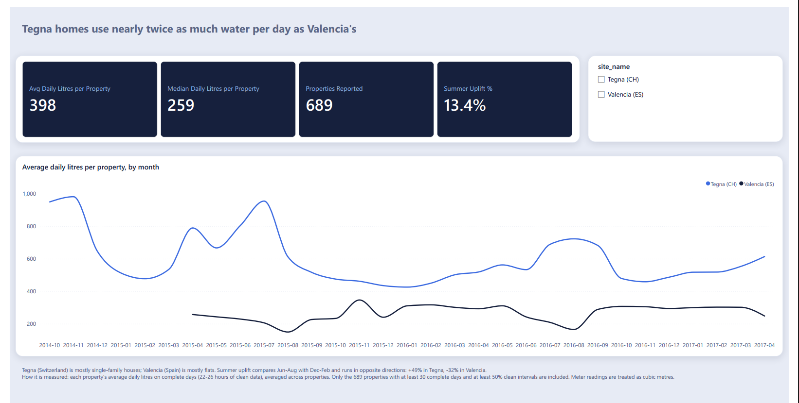
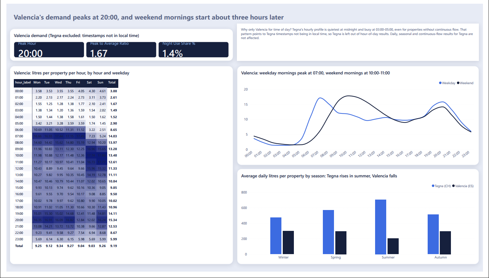
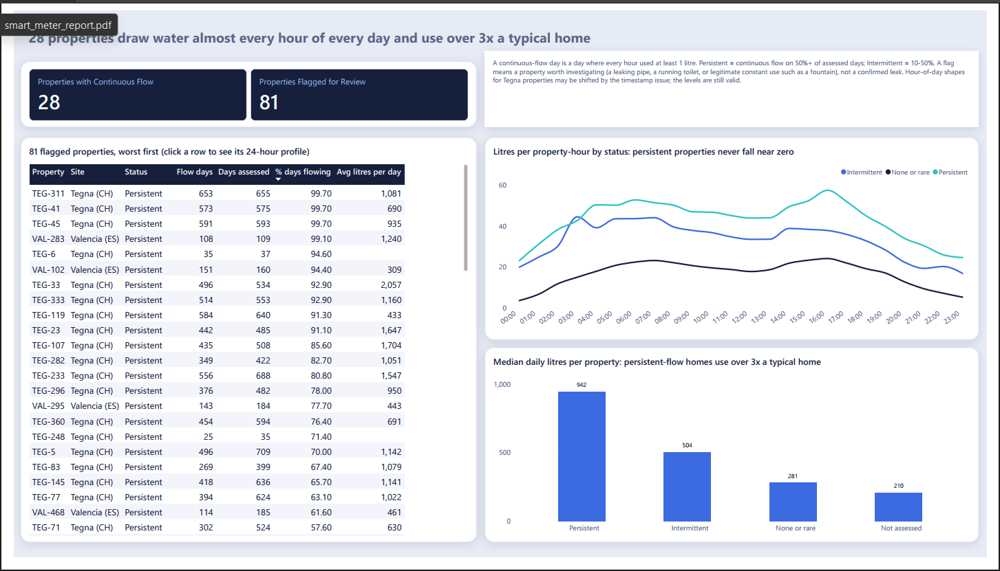
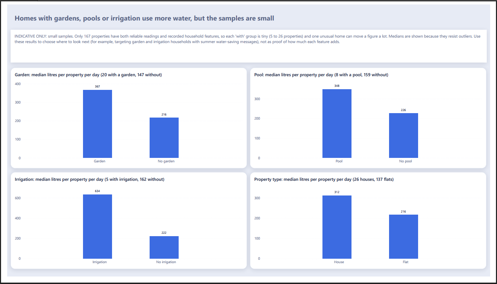
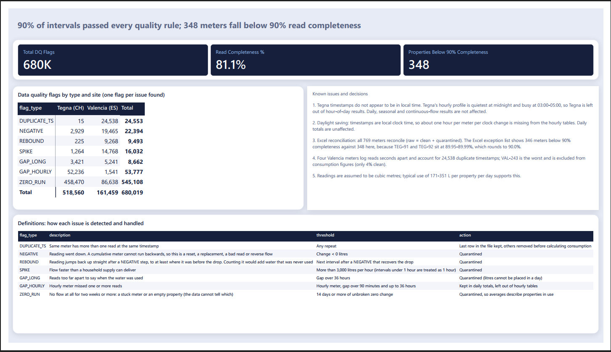

# Smart Meter Consumption Reporting

**Turning 6.3 million raw water meter reads into trusted consumption, demand, leakage and water-efficiency reporting with SQL, Excel and Power BI.**



| | |
|---|---|
| **Data** | 769 household water smart meters, Tegna (Switzerland) and Valencia (Spain), Oct 2014 to Apr 2017 |
| **Stack** | PostgreSQL (load, cleanse, model), Excel (independent reconciliation), Power BI (star schema, DAX, report) |
| **Outputs** | 5-page Power BI report, data quality ruleset, reconciliation workbook, [insight summary](docs/insight_summary.md) |

---

## 1. Business problem

Smart meters replace a reading every six months with a reading every hour. That only helps if the data can be trusted and turned into decisions. A water company's consumption team needs to know how much each property uses and how that changes by season, when demand peaks so the network can be managed, which properties show signs of a leak, and which households to target with water-efficiency advice. Raw meter data arrives as cumulative totals with gaps, resets, stuck meters and spikes, so the first job is building a pipeline that finds and quarantines bad data without losing a litre. This project builds that pipeline end to end and answers five business questions on top of it. Open UK water smart meter data is hard to find, so it uses the published SmartH2O datasets from Switzerland and Spain; the methods transfer directly to a UK meter estate.

| Question | Measure | Page |
|---|---|---|
| How much does each property use, and how does it change by season and day? | Average and median litres per property per day, summer uplift | Overview, Patterns |
| When is demand highest? | Hourly profile, peak hour, peak-to-average ratio | Patterns |
| Which properties may have a leak? | Continuous flow status, night use share | Continuous flow |
| How much do gardens, pools and irrigation add? | Median use by household feature | Water efficiency |
| How far can the data be trusted? | Read completeness %, flags by type | Data quality |

## 2. Dashboard preview

| | |
|---|---|
|  **Overview**: Tegna homes use nearly twice as much water per day as Valencia's |  **Patterns**: Valencia's demand peaks at 20:00; weekend mornings start about three hours later |
|  **Continuous flow**: 28 properties draw water almost every hour of every day |  **Water efficiency**: gardens, pools and irrigation lift use, but samples are small |
|  **Data quality**: 90% of intervals passed every rule; 348 meters below 90% completeness | |

- Power BI file: [`powerbi/smart_meter_report.pbix`](powerbi/smart_meter_report.pbix)
- PDF export: [`powerbi/smart_meter_report.pdf`](powerbi/smart_meter_report.pdf)

## 3. Data

**Source:** *The SmartH2O anonymized datasets of Terre di Pedemonte and Valencia*, v1.0, published on Zenodo on 19 April 2017 ([record 556152](https://zenodo.org/record/556152)). Cumulative meter readings plus a household features file (garden, pool, irrigation, property type). Data come from the SES water utility (Terre di Pedemonte/Tegna) and EMIVASA (Valencia).

**Licence:** open access on Zenodo. The raw files are not redistributed in this repository (see `.gitignore`); download them from the link above to rerun the project.

**What the data can answer:** household consumption per property, daily and seasonal patterns, hourly patterns (Valencia), continuous flow, data quality.

**What it cannot answer:**
- **No business (non-household) meters**, so the project covers household consumption only.
- **No occupancy field**, so consumption is reported per property, not per person.
- **Household features are sparse:** only 167 of the reportable properties have them, so the water-efficiency results are indicative.
- **Tegna timestamps do not appear to be local time**, so Tegna is excluded from hour-of-day results (details in section 4).

**Profiled facts** ([profiling note](docs/profiling_note.md)): 6,289,251 reads; Tegna 98% hourly, Valencia a mix of hourly (147 meters) and daily (215) reads. Readings are treated as cubic metres: typical use of 171 to 351 litres per property per day supports this.

## 4. Data quality

Consumption is the difference between consecutive cumulative reads (`LAG()` over each meter). Every interval is then tested against seven rules. Flagged intervals are **quarantined, not deleted**: `reading_intervals` keeps every row, and the reporting tables read only from `clean_intervals`.

| Flag | Rule | Tegna | Valencia | Handling |
|---|---|---|---|---|
| DUPLICATE_TS | Same meter, same timestamp | 15 | 24,538 | Last row kept |
| NEGATIVE | Reading went down | 2,929 | 19,465 | Quarantined |
| REBOUND | Jump back after a drop, recovering it | 225 | 9,268 | Quarantined |
| SPIKE | Over 3,000 L/hour | 1,264 | 14,768 | Quarantined |
| GAP_LONG | Over 36 hours between reads | 3,421 | 5,241 | Quarantined |
| GAP_HOURLY | Hourly meter missed reads (90 min to 36 h) | 52,236 | 1,541 | Kept in daily, excluded from hourly |
| ZERO_RUN | 14+ days with no flow | 458,470 | 86,638 | Quarantined |

**Result:** 90.0% of Tegna and 91.8% of Valencia intervals are clean. Before cleaning, Tegna's mean daily use was **-7 million litres** (meter resets in the billions); after cleaning it is 560. Thresholds and reasoning: [Step 3 note](docs/step3_note.md).

**Reconciliation:** an Excel workbook recomputes every meter's total from its first and last reading and confirms that recorded litres = clean + quarantined litres, and clean litres = what Power BI reads. **769 of 769 meters reconcile**; total clean volume 154,089,160 litres matches across SQL, Excel and Power BI ([Step 5 note](docs/step5_note.md)).

**Known issues and decisions**
1. **Tegna timestamps.** Tegna's hourly profile is quietest at midnight and busy at 03:00-05:00 even for properties without continuous flow, which indicates the timestamps are not local time. The offset could not be pinned down, so no correction was applied and Tegna is excluded from hour-of-day results.
2. **Daylight saving.** Timestamps are local clock time; about one hour per meter per clock change is missing from hourly tables. Daily totals are unaffected.
3. **Rounding.** Excel lists 346 meters below 90% completeness against 348 in SQL, because TEG-91 and TEG-92 sit at 89.95-89.99% and round to 90.0%.
4. **Faulty meters.** Four Valencia meters log reads seconds apart. VAL-243 (4% clean) is excluded from consumption figures by the reportable-property rule.

## 5. Key findings and recommendations

Full write-up: [insight summary](docs/insight_summary.md).

**Findings**
1. **Use differs sharply by place and season.** Tegna: 554 L per property per day (median 459). Valencia: 290 (median 207). Summer use rises 49% in Tegna but falls 32% in Valencia.
2. **28 properties show persistent continuous flow** (water used in every hour on at least half their days). Their median use is 942 L/day against 281 for typical homes (3.4x); TEG-311, TEG-41 and TEG-45 flowed on 99.7% of days.
3. **The data is usable but has gaps.** 90% of intervals are clean and every meter reconciles, but 348 meters (45%) fall below 90% read completeness and Tegna's timestamps cannot be used for time of day. In Valencia, demand peaks at 20:00 (1.7x the average hour).

**Recommendations**
1. **Investigate the 28 persistent-flow properties first**, starting with those flowing on 90%+ of days. Roughly 18,500 litres a day would be saved if they used the same as a typical home (indicative).
2. **Time water-efficiency messages to the summer peak and aim them at outdoor use** (garden 367 vs 216 L/day; irrigation 634 vs 222), while treating the small samples as a lead to test.
3. **Fix the data foundations:** confirm the timestamp convention with the supplier, investigate the outages behind low-completeness meters, and agree a rounding rule for thresholds.

## 6. Data dictionary and measure definitions

Full dictionary with every column: [docs/data_dictionary.md](docs/data_dictionary.md). The `rpt` schema also carries `COMMENT`s on every table and key column.

**Reporting tables (PostgreSQL `rpt` schema, loaded into Power BI)**

| Table | Grain | Purpose |
|---|---|---|
| `dim_property` | One row per meter (769) | Site, cadence, household features, read completeness %, clean %, continuous flow status |
| `dim_date` | One row per day | Year, month, weekday, weekend flag, meteorological season |
| `dim_hour` | One row per hour (24) | Hour label, day period, 02:00-04:00 night window flag |
| `dim_dq_flag` | One row per rule (7) | Description, threshold, action |
| `fact_daily_consumption` | Property x day | Clean litres, coverage hours, complete-day flag, night litres, continuous-flow day flag |
| `fact_hourly_consumption` | Property x hour | Clean litres (hourly meters only; quarantined hours have no row) |
| `fact_dq_flags` | Property x day x flag type | Number of flags |

**Key definitions**
- **Complete day:** 22 to 26 hours of clean data behind the daily total. Averages use complete days only.
- **Reportable property:** at least 30 complete days and at least 50% clean intervals (689 of 769).
- **Continuous-flow day:** an hourly-meter day with 23+ hours recorded where every hour used at least 1 litre.
- **Continuous flow status:** Persistent = continuous flow on 50%+ of complete days (minimum 7); Intermittent = 10-50%; Not assessed = not an hourly meter or under 30 complete days.
- **Read completeness %:** share of expected hours (hourly meters) or days (other meters) between first and last read that received a read.

**DAX measures** (source: [`powerbi/measures.dax`](powerbi/measures.dax))

| Measure | Definition |
|---|---|
| Total Litres | Sum of clean daily litres |
| Avg Daily Litres per Property | Each reportable property's average over complete days, averaged across properties |
| Median Daily Litres per Property | As above, but the median property |
| Properties Reported | Number of properties behind the two figures above |
| Summer Uplift % | Average in summer (Jun-Aug) against winter (Dec-Feb) |
| Avg Litres per Property Hour | Average clean litres per property per hour |
| Peak Hour | Hour with the highest average in the 24-hour profile |
| Peak to Average Ratio | Busiest hour divided by the average hour |
| Night Use Share % | Litres used 02:00-04:00 as a share of the day, on days with 23+ hours recorded |
| Properties with Continuous Flow | Properties with Persistent status |
| Properties Flagged for Review | Properties with Persistent or Intermittent status |
| Read Completeness % | Average read completeness across properties |
| Properties Below 90% Completeness | Properties under the 90% threshold |
| Total DQ Flags | Number of data quality flags |

## 7. Product catalogue entry

| | |
|---|---|
| **Product** | Smart Meter Consumption Report |
| **Owner** | Iyeose Simon, Data Analyst |
| **Audience** | data team; demand planning; leakage team (continuous flow list); water efficiency team |
| **Data source** | SmartH2O open dataset via PostgreSQL `rpt` schema |
| **Refresh** | Static historical dataset. In production: daily load of new reads, rerun SQL steps 01-05, then Power BI refresh |
| **Quality gate** | Reconciliation must show 0 CHECK meters before a refresh is published |
| **Review date** | 13 February 2027 |
| **Retire when** | Replaced by reporting on the company's own meter estate, or if the leak list and demand pages are not used for two review cycles |

## 8. How to run it

**Prerequisites:** PostgreSQL 16+ (with `psql`), Power BI Desktop, Excel (2016 or later).

**Folder structure**
```
smart-meter-reporting/
├── data/raw/            # SmartH2O CSVs (not in repo: download from Zenodo)
│   ├── tegna/
│   └── valencia/
├── sql/
│   ├── 01_load_raw.sql        # load CSVs as text, type them, add site + meter_key
│   ├── 02_profile.sql         # profiling queries, builds meters table
│   ├── 03_consumption.sql     # LAG() consumption, hour/day placement
│   ├── 04_dq_flags.sql        # 7 rules, dq_flags, clean_intervals
│   ├── 05_reporting.sql       # rpt schema for Power BI
│   └── 06_export_excel.sql    # CSVs for the reconciliation workbook
├── excel/
│   ├── reconciliation.xlsx
│   └── data/                  # CSVs written by 06_export_excel.sql
├── powerbi/
│   ├── smart_meter_report.pbix
│   ├── smart_meter_report.pdf
│   ├── measures.dax
│   └── smart_meter_theme_light.json / _dark.json
└── docs/                      # profiling note, step notes, insight summary, data dictionary, images
```

**Steps**
1. Download `datasets-v1.0.zip` from [Zenodo](https://zenodo.org/record/556152). Unzip it, then unzip `Tegna/anonymizer.zip` into `data/raw/tegna/` and `Valencia/anonymizer.zip` into `data/raw/valencia/`.
2. In `psql`, run `CREATE DATABASE smart_meter;` and then `\c smart_meter`.
3. Run the scripts in order. Edit the `\cd` path at the top of `01_load_raw.sql` and `06_export_excel.sql` if your folder is not `C:/smart-meter-reporting`:
   ```
   \i C:/smart-meter-reporting/sql/01_load_raw.sql
   \i C:/smart-meter-reporting/sql/02_profile.sql
   \i C:/smart-meter-reporting/sql/03_consumption.sql
   \i C:/smart-meter-reporting/sql/04_dq_flags.sql
   \i C:/smart-meter-reporting/sql/05_reporting.sql
   \i C:/smart-meter-reporting/sql/06_export_excel.sql
   ```
   Each script prints checks with the expected results documented in its step note.
4. Open `excel/reconciliation.xlsx` and choose **Data > Refresh All**. The Summary sheet should show 769 OK and 0 CHECK.
5. Open `powerbi/smart_meter_report.pbix`. If your database is not on `localhost`, change it in **Transform data > Data source settings**, then choose **Refresh**.

**Step notes:** [profiling](docs/profiling_note.md) · [consumption](docs/step2_note.md) · [data quality](docs/step3_note.md) · [reporting layer](docs/step4_note.md) · [reconciliation](docs/step5_note.md) · [Power BI](docs/step6_note.md)
